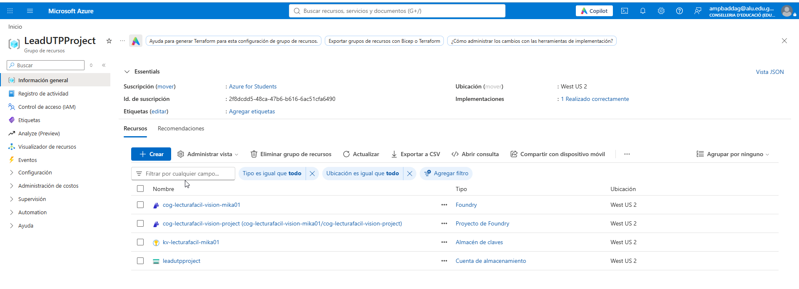

# 📚 LecturaFácil Azure - Asistente Infantil de Lectura

Aplicación web interactiva para que niños de 5 años pratiquen su ficha semanal
de lectura en **castellano** y **valenciano**.

Ejemplo de recursos desplegados:


Los padres suben una foto de la ficha; el backend la guarda en Azure Blob
Storage, extrae las palabras con Azure AI Vision (OCR) y muestra una tarjeta por
palabra con:

- 🔊 un botón de **altavoz** para escuchar la pronunciación correcta (Text-to-Speech),
- 🎤 un botón de **micrófono** para que la niña diga la palabra (Speech-to-Text),
- ✅ feedback visual: borde verde brillante, sonido alegre y el mensaje
  **"¡Muy bien! / Molt bé!"** cuando la pronunciación es correcta.

---

## 🚀 Arquitectura y servicios de Azure

| Capa | Tecnología |
|---|---|
| Interfaz | HTML5 + CSS + JavaScript (sin CDN, todo local) |
| Backend | FastAPI (Python 3.11+) |
| Cómputo | Azure App Service (Linux, Python 3.12) |
| OCR | Azure AI Vision (Read 4.0) o Azure AI Document Intelligence |
| Voz | Azure AI Speech Service (`es-ES`, `ca-ES`) |
| Almacenamiento | Azure Blob Storage (contenedor `fichas-lectura`) |
| Seguridad | Managed Identity (DefaultAzureCredential) + Azure Key Vault |
| IaC | Bicep (`infra/main.bicep`) |

El reconocimiento de voz usa primero la **Web Speech API del navegador**
(instantáneo y sin coste) y cae a **Azure AI Speech** cuando el navegador no la
soporta (Safari/Firefox), enviando audio WAV PCM 16 kHz.

---

## 📦 Estructura del proyecto

```text
├── docs/
│   ├── Initial.md               # Requisitos originales
│   ├── guiadeservicios.md       # Guía paso a paso de Azure
│   ├── TAREAS.md                # Lista de tareas y estado
│   └── python-instructions.md   # Convenciones del repositorio
├── infra/
│   └── main.bicep               # Infraestructura como código
├── app/
│   ├── main.py                  # Fábrica FastAPI + composición
│   ├── container.py             # Punto de composición de servicios
│   ├── core/                    # config, errores, i18n, auth, media, logging
│   ├── api/
│   │   ├── dependencies.py      # Inyección de dependencias
│   │   └── routes/              # pages, sheets, speech, profiles
│   ├── schemas/                 # DTOs Pydantic v2
│   ├── services/
│   │   ├── ocr/                 # Puertos + proveedores Azure + extracción
│   │   ├── speech.py            # TTS + STT
│   │   ├── storage.py           # Blob Storage (+ memoria)
│   │   ├── profiles.py          # Perfiles sin contraseña
│   │   ├── translation.py       # Traducción con Azure AI Foundry (opcional)
│   │   └── evaluation.py        # Lógica de evaluación
│   ├── static/
│   │   ├── css/kids.css         # Estilo infantil y responsive
│   │   └── js/{app,recorder}.js # Interfaz + grabación WAV
│   └── templates/               # Jinja2 (base.html, index.html)
├── tests/                       # unit/ + integration/
├── requirements.txt
├── requirements-dev.txt
└── pyproject.toml
```

---

## 🛠️ Configuración local

```powershell
# 1. Entorno virtual
python -m venv .venv
.venv\Scripts\activate

# 2. Dependencias
pip install -r requirements-dev.txt

# 3. Variables de entorno
copy .env.example .env
```

### Opción A · Modo demostración (sin Azure)

```env
LECTURA_DEMO_MODE=true
```

El OCR devuelve una ficha de ejemplo, las imágenes se guardan en memoria y la
voz usa el navegador. Ideal para probar la interfaz.

### Opción B · Con servicios reales

```env
LECTURA_DEMO_MODE=false
LECTURA_VISION_ENDPOINT=https://cog-lecturafacil-vision-<sfx>.cognitiveservices.azure.com/
LECTURA_BLOB_SERVICE_URL=https://leadutpproject.blob.core.windows.net/
LECTURA_BLOB_CONTAINER=fichas-lectura
LECTURA_SPEECH_REGION=westus2
LECTURA_SPEECH_KEY=...            # solo si trabajas sin Managed Identity
```

```powershell
python -m uvicorn app.main:app --reload
```

Abre <http://127.0.0.1:8000>. La documentación de la API está en `/docs`.

> Con `az login` y los recursos desplegados basta con `LECTURA_BLOB_SERVICE_URL`
> y el endpoint de visión: la Managed Identity sustituye a las claves.

---

## 🔌 Endpoints

| Método | Ruta | Descripción |
|---|---|---|
| `GET` | `/` | Interfaz infantil (respeta `?lang=ca` y la cookie `lang`) |
| `POST` | `/api/upload-sheet` | Multipart: `file`, `language` (`auto`/`es`/`ca`), `max_words` → palabras detectadas |
| `POST` | `/api/evaluate-speech` | Compara la transcripción con la palabra → `correct`, `score` y mensaje traducido |
| `POST` | `/api/tts` | Devuelve el audio MP3 de una palabra |
| `POST` | `/api/recognize-speech` | Multipart: audio WAV 16 kHz → transcripción |
| `POST` | `/api/translate-words` | Traduce las palabras al otro idioma con un modelo de Foundry (opcional) |
| `GET` | `/api/profiles` | Lista de perfiles (por defecto, dos) |
| `POST` | `/api/profiles` | Crea un perfil (nombre + avatar) |

Ejemplo:

```bash
curl -X POST http://127.0.0.1:8000/api/evaluate-speech \
  -H "Content-Type: application/json" \
  -d '{"expected_word":"mariposa","spoken_text":"mariposa","language":"ca"}'
# {"correct":true,"score":1.0,"message":"Molt bé!","feedback_key":"feedback.perfect","heard":"mariposa"}
```

---

## ✅ Calidad

```bash
pytest                              # 83 tests, ~86 % de cobertura
black --check app tests
isort --check-only --profile black app tests
ruff check app tests
mypy app tests
```

---

## 🚀 Despliegue en Azure

1. Sigue la guía completa: [`docs/guiadeservicios.md`](docs/guiadeservicios.md).
2. O aprovisiona el resto de recursos con Bicep (reutiliza tu cuenta de
   almacenamiento existente `leadutpproject`):

```powershell
az deployment group create -g LeadUTPProject `
  --template-file infra/main.bicep `
  --parameters blobAccountName="leadutpproject" uniqueSuffix="<sfx>" location="westus2" speechRegion="westus2"
```

3. Estado de las tareas: [`docs/TAREAS.md`](docs/TAREAS.md).